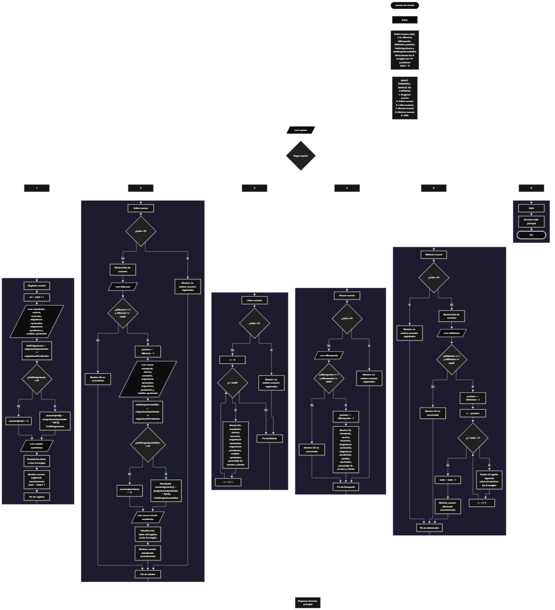

Este proyecto, llamado <b>avance de carrera</b>, fue desarrollado en <b>Java</b> como un ejercicio práctico para fortalecer la lógica de programación mediante la creación de un sistema de seguimiento del avance académico de estudiantes desde la consola. El programa cuenta con un menú principal de seis opciones que permite <b>registrar, editar, listar, buscar y eliminar avances académicos</b>, además de finalizar la ejecución del sistema. Cada registro almacena información como el nombre del estudiante, la carrera, el semestre actual, las asignaturas aprobadas, las asignaturas pendientes, los créditos aprobados y el estado académico. También calcula automáticamente el porcentaje de avance según la cantidad de asignaturas aprobadas y pendientes. Para almacenar esta información, utiliza ocho arreglos con una capacidad máxima de <b>10 registros durante la ejecución</b>. Durante su desarrollo se aplicaron conceptos fundamentales de programación, como variables, arreglos, estructuras condicionales, ciclos repetitivos y estructuras de selección, además de operaciones para buscar, modificar, eliminar y organizar registros. Este proyecto permite poner en práctica los conocimientos adquiridos en Java y sirve como base para desarrollar sistemas de gestión académica más avanzados utilizando otros lenguajes y tecnologías.

<h2 align="center">⚙️ Funcionamiento del menú principal</h2>

### ➕ Registrar avance

La opción <b>1) registrar avance</b> permite agregar un nuevo registro académico al sistema. Para comenzar, el programa genera un identificador mediante la expresión <b>total + 1</b>, mostrando el ID correspondiente al nuevo registro. Después, solicita el <b>nombre del estudiante, carrera, semestre actual, asignaturas aprobadas, asignaturas pendientes y créditos aprobados</b>. Una vez capturados estos datos, calcula la cantidad total de asignaturas mediante la suma de las asignaturas aprobadas y pendientes, utilizando la variable <b>totalAsignaturas</b>. Si el resultado es mayor que cero, calcula automáticamente el porcentaje de avance mediante la fórmula <b>(asignaturas aprobadas * 100.0) / totalAsignaturas</b>. Si la cantidad total de asignaturas es cero, establece el avance en <b>0</b>. Finalmente, solicita el estado académico, almacena la información en los ocho arreglos, muestra el mensaje <b>"Avance registrado correctamente."</b> y aumenta la variable <b>total</b> en uno.

### ✏️ Editar avance

La opción <b>2) editar avance</b> permite modificar la información de un registro académico existente. Primero, el programa comprueba si existen avances almacenados mediante la condición <b>total == 0</b>. Si no hay registros, muestra el mensaje <b>"No existen avances registrados."</b>. En caso contrario, presenta una lista con el ID, estudiante, carrera, semestre, asignaturas aprobadas, asignaturas pendientes, créditos aprobados, porcentaje de avance y estado académico de cada registro. Después, solicita el ID del avance que se desea editar y comprueba que esté dentro del rango permitido mediante la condición <b>idBuscar >= 1 && idBuscar <= total</b>. Si la selección es válida, calcula la posición correspondiente utilizando <b>idBuscar - 1</b> y solicita los nuevos datos del estudiante. Una vez actualizada la información, calcula nuevamente el total de asignaturas mediante la variable <b>totalAsignaturasEditar</b> y obtiene el nuevo porcentaje de avance. Si el total de asignaturas es cero, establece el porcentaje en <b>0</b>. Finalmente, solicita el nuevo estado académico y muestra el mensaje <b>"Avance actualizado correctamente."</b>. Si el ID seleccionado no corresponde a un registro existente, presenta el mensaje <b>"ID no encontrada."</b>.

### 📋 Listar avances

La opción <b>3) listar avances</b> permite visualizar todos los registros académicos almacenados actualmente en el sistema. Antes de mostrar la información, el programa comprueba si la variable <b>total</b> es igual a cero. Si no existen avances registrados, presenta el mensaje <b>"No existen avances registrados."</b>. Si hay registros disponibles, utiliza un ciclo <b>for</b> para recorrer los ocho arreglos desde la primera posición hasta la cantidad total de registros. Durante el recorrido, muestra el ID, nombre del estudiante, carrera, semestre actual, asignaturas aprobadas, asignaturas pendientes, créditos aprobados, porcentaje de avance y estado académico. Para presentar el porcentaje con dos decimales, utiliza la instrucción <b>String.format("%.2f", avances[i])</b>. Esta función facilita consultar los registros académicos sin necesidad de buscar cada estudiante individualmente.

### 🔎 Buscar avance

La opción <b>4) buscar avance</b> permite localizar un registro académico mediante su ID. Primero, el programa comprueba si existen avances registrados. Si el sistema está vacío, muestra el mensaje <b>"No existen avances registrados."</b>. En caso contrario, solicita el ID del avance que se desea buscar y comprueba que se encuentre dentro del rango válido mediante la condición <b>idBusqueda >= 1 && idBusqueda <= total</b>. Si el identificador es válido, calcula la posición correspondiente utilizando <b>idBusqueda - 1</b> y muestra los datos completos del registro encontrado: estudiante, carrera, semestre, asignaturas aprobadas, asignaturas pendientes, créditos aprobados, porcentaje de avance y estado académico. El porcentaje se presenta con dos decimales mediante <b>String.format("%.2f", avances[posicion])</b>. Si el ID introducido no corresponde a ningún registro existente, presenta el mensaje <b>"ID no encontrada."</b>.

### 🗑️ Eliminar avance

La opción <b>5) eliminar avance</b> permite eliminar un registro académico mediante su ID. Antes de comenzar, el programa comprueba que existan avances almacenados. Si no hay registros, muestra el mensaje <b>"No existen avances registrados."</b>. Si existen registros disponibles, presenta una lista con los datos académicos de cada estudiante y solicita el ID del avance que se desea eliminar. Después, verifica que el identificador esté dentro del rango válido. Si la selección es correcta, calcula la posición utilizando <b>idEliminar - 1</b> y comienza el proceso de eliminación. Para mantener los registros organizados, utiliza un ciclo <b>for</b> que desplaza una posición hacia la izquierda los datos de los registros posteriores en los ocho arreglos: <b>estudiantes, carreras, semestres, asignaturasAprobadas, asignaturasPendientes, creditosAprobados, avances y estados</b>. Posteriormente, disminuye la variable <b>total</b> en uno y muestra el mensaje <b>"Avance eliminado correctamente."</b>. Si el ID seleccionado no corresponde a un registro existente, presenta el mensaje <b>"ID no encontrada."</b>.

### 🚪 Salir del menú principal

La opción <b>6) salir</b> permite finalizar la ejecución del programa y muestra el mensaje <b>"Gracias por utilizar Avance de Carrera."</b>. El menú principal se encuentra dentro de una estructura repetitiva <b>do-while</b>, que mantiene el sistema en funcionamiento mientras el usuario realiza las operaciones disponibles. La condición <b>opcion != 6</b> permite repetir el menú hasta que se seleccione la opción 6. Cuando esto sucede, el ciclo termina y se ejecuta <b>entrada.close()</b> para cerrar el objeto Scanner utilizado para capturar los datos ingresados por teclado.

<h2 align="center">🧠 Temas aplicados en el proyecto</h2>

### 📦 Variables

En este proyecto se utilizan variables para controlar la opción seleccionada en el menú, almacenar la cantidad de avances registrados, generar identificadores, seleccionar los registros que se desean editar, buscar o eliminar, calcular la cantidad total de asignaturas y obtener el porcentaje de avance académico. Cada variable cumple una función específica dentro de las operaciones de gestión de los registros académicos.

🔢 **Opcion:** Almacena la opción seleccionada por el usuario en el menú principal.

📊 **Total:** Almacena la cantidad actual de avances académicos registrados.

🔄 **I:** Funciona como contador en los ciclos <b>for</b> y permite recorrer los arreglos.

🆔 **Id:** Almacena el identificador generado para un nuevo registro académico.

✏️ **IdBuscar:** Almacena el ID introducido por el usuario para seleccionar un avance que desea editar.

🔎 **IdBusqueda:** Almacena el ID introducido para localizar un avance académico.

🗑️ **IdEliminar:** Almacena el ID del registro que se desea eliminar.

📍 **Posicion:** Almacena la posición del arreglo correspondiente al ID seleccionado, calculada mediante la resta de uno.

📚 **TotalAsignaturas:** Almacena la suma de las asignaturas aprobadas y pendientes durante el registro de un avance.

📚 **TotalAsignaturasEditar:** Almacena la suma de las asignaturas aprobadas y pendientes cuando se modifica un registro académico.

📈 **Avances:** Almacena el porcentaje de avance académico calculado para cada estudiante mediante las asignaturas aprobadas y pendientes.

### 🗃️ Arreglos

En este proyecto se utilizan ocho arreglos relacionados con la información académica de cada estudiante. Cada arreglo tiene una capacidad de <b>10 posiciones</b> y utiliza el mismo índice para representar los datos correspondientes a un mismo registro. Por ejemplo, la información de un estudiante almacenado en la posición <b>0</b> se encuentra distribuida entre <b>estudiantes[0], carreras[0], semestres[0], asignaturasAprobadas[0], asignaturasPendientes[0], creditosAprobados[0], avances[0] y estados[0]</b>. Esta organización permite recorrer, buscar, modificar, mostrar y eliminar los registros académicos de manera coordinada.

🎓 **Estudiantes[10]:** Almacena los nombres de los estudiantes registrados.

📚 **Carreras[10]:** Almacena los nombres de las carreras que cursan los estudiantes.

📅 **Semestres[10]:** Almacena los semestres actuales de cada estudiante.

✅ **AsignaturasAprobadas[10]:** Almacena la cantidad de asignaturas aprobadas.

⏳ **AsignaturasPendientes[10]:** Almacena la cantidad de asignaturas pendientes.

🎯 **CreditosAprobados[10]:** Almacena la cantidad de créditos aprobados por cada estudiante.

📈 **Avances[10]:** Almacena el porcentaje de avance académico calculado automáticamente.

📋 **Estados[10]:** Almacena los estados académicos de los estudiantes.

### 🔀 Estructuras condicionales

En este proyecto se utiliza la estructura <b>if-else</b> para comprobar si existen avances registrados antes de realizar determinadas operaciones, validar los identificadores seleccionados para editar, buscar o eliminar un registro y determinar si la cantidad total de asignaturas es mayor que cero antes de calcular el porcentaje de avance académico. Cuando no existen asignaturas aprobadas ni pendientes, el programa establece el porcentaje en <b>0</b>. Estas condiciones permiten que el sistema responda de manera diferente según la información almacenada y el resultado de cada operación.

### 🔄 Estructuras repetitivas

En este proyecto se utilizan los ciclos <b>for</b> y <b>do-while</b>. Los ciclos <b>for</b> permiten recorrer los arreglos para mostrar los avances académicos registrados y acceder a sus respectivos datos. Durante la eliminación, también se utiliza un ciclo <b>for</b> para desplazar los registros posteriores una posición hacia la izquierda en los ocho arreglos. Por otro lado, el ciclo <b>do-while</b> mantiene activo el menú principal y permite ejecutar diferentes operaciones hasta que el usuario selecciona la opción de salida.

### 🎯 Estructura switch-case

El programa utiliza la estructura <b>switch-case</b> para evaluar el valor almacenado en la variable <b>opcion</b> y ejecutar el bloque de instrucciones correspondiente. Cada caso representa una operación específica del sistema: <b>registrar, editar, listar, buscar, eliminar o salir</b>. También se utiliza el bloque <b>default</b> para mostrar el mensaje <b>"Opcion no valida."</b> cuando el usuario introduce un número que no coincide con ninguna de las opciones definidas en el menú.

### 🔢 Dimensionamiento de arreglos

El programa utiliza la declaración de arreglos en Java para establecer la capacidad de los espacios destinados a almacenar la información académica de los estudiantes. Se definieron <b>ocho arreglos de 10 posiciones cada uno</b>, lo que permite administrar hasta 10 registros durante la ejecución. La cantidad de posiciones ocupadas se controla mediante la variable <b>total</b>, por lo que las operaciones recorren únicamente los registros comprendidos entre la primera posición y la cantidad actual de avances académicos.

### 🧮 Cálculo del porcentaje de avance

Una de las funcionalidades principales del proyecto es el cálculo automático del porcentaje de avance académico de cada estudiante. Para obtenerlo, el programa suma las asignaturas aprobadas y las asignaturas pendientes, utilizando esta cantidad como total de asignaturas. Después, divide las asignaturas aprobadas entre el total y multiplica el resultado por <b>100.0</b> para obtener el porcentaje. La fórmula utilizada es la siguiente: <b>[text{Avance} = frac { text{Asignaturas aprobadas}} text{Asignaturas aprobadas} + text{Asignaturas pendientes}} times 100]</b>

Este cálculo se realiza tanto al registrar como al editar un avance académico. Si la suma de las asignaturas aprobadas y pendientes es mayor que cero, se obtiene el porcentaje correspondiente. De lo contrario, el programa establece el avance en <b>0</b>. Para mostrar el resultado con dos cifras decimales, utiliza <b>String.format("%.2f", avances[i])</b>.

### 🔄 Reorganización de registros

Cuando se selecciona un avance académico para eliminarlo, el programa utiliza un ciclo <b>for</b> que comienza en la posición seleccionada y continúa mientras <b>i &lt; total - 1</b>. En cada repetición, los datos de la posición siguiente se copian sobre la posición actual en los ocho arreglos: <b>estudiantes, carreras, semestres, asignaturasAprobadas, asignaturasPendientes, creditosAprobados, avances y estados</b>. Después, la variable <b>total</b> disminuye en uno. De esta manera, los registros posteriores ocupan las posiciones disponibles sin dejar espacios vacíos entre los registros activos. La última posición no se limpia explícitamente, pero deja de formar parte de los registros activos al disminuir el contador.

<h2 align="center">¿Cómo se implementaron las operaciones CRUD en el proyecto?</h2>

Las operaciones <b>CRUD</b> se implementaron mediante las opciones del menú principal, permitiendo administrar los avances académicos registrados. La operación <b>crear</b> corresponde a <b>registrar avance</b>, donde se introducen los datos de un estudiante y se calcula su porcentaje académico; <b>leer</b> se realiza mediante las opciones <b>buscar avance y listar avances</b>, que permiten consultar la información almacenada; <b>actualizar</b> corresponde a <b>editar avance</b>, donde se modifican los datos de un registro y se calcula nuevamente su porcentaje; y <b>eliminar</b> se realiza mediante la opción <b>eliminar avance</b>. Estas operaciones utilizan variables, arreglos, estructuras condicionales, ciclos y cálculos matemáticos para gestionar la información almacenada temporalmente durante la ejecución del programa.

<h2 align="center">Diagrama de flujo del proyecto</h2>

<h2 align="center">🛡️ Validaciones del programa</h2>

### 📭 No existen avances registrados

Esta validación se utiliza en las opciones de <b>editar, listar, buscar y eliminar avances</b>. El programa comprueba si la variable <b>total</b> es igual a <b>0</b> y, si no existen registros académicos, muestra el mensaje <b>"No existen avances registrados."</b>. Esta comprobación evita continuar con las operaciones que necesitan información almacenada cuando el sistema está vacío.

### 🔢 Selección de avances académicos

El programa utiliza las variables <b>idBuscar, idBusqueda e idEliminar</b> para identificar el registro académico que se desea editar, buscar o eliminar. Antes de realizar estas operaciones, comprueba que el identificador introducido sea mayor o igual a <b>1</b> y menor o igual al valor de <b>total</b>. Si la selección está fuera de ese rango, muestra el mensaje <b>"ID no encontrada."</b>. Esta validación evita modificar, consultar o eliminar posiciones que no corresponden a registros existentes.

### 🧮 Total de asignaturas igual a cero

Esta validación se utiliza durante el registro y la edición de los avances académicos. El programa comprueba si la suma de las asignaturas aprobadas y pendientes es mayor que <b>0</b>. Si existe una cantidad válida para realizar el cálculo, obtiene el porcentaje de avance correspondiente. En caso contrario, establece el valor de <b>avances</b> en <b>0</b>, evitando realizar una división entre cero.

### ⚠️ Capacidad máxima de los arreglos

Los ocho arreglos utilizados en el programa tienen una capacidad de <b>10 posiciones</b>. Sin embargo, el código actual no incluye una condición que compruebe si la cantidad de registros es menor que 10 antes de realizar un nuevo registro. Por este motivo, si se intenta registrar un undécimo avance académico, el programa puede generar una excepción <b>ArrayIndexOutOfBoundsException</b> al intentar acceder a una posición que no existe en los arreglos.

### ❌ Opción inválida

La estructura <b>switch-case</b> incluye el bloque <b>default</b>, que muestra el mensaje <b>"Opcion no valida."</b> cuando el usuario introduce un número que no corresponde a ninguna de las seis opciones definidas en el menú. Esta condición permite informar al usuario cuando selecciona una opción que no está disponible en el sistema.

### ⚠️ Entrada de datos

El programa utiliza el objeto <b>Scanner</b> para capturar la información introducida por el usuario mediante el teclado. Después de utilizar <b>nextInt()</b>, se emplea <b>nextLine()</b> para consumir el salto de línea pendiente antes de capturar nuevos datos de texto. Sin embargo, el código actual no contempla el tratamiento de entradas incompatibles con el tipo de dato solicitado. Por ejemplo, introducir texto cuando el programa espera un número mediante <b>nextInt()</b> puede generar una excepción <b>InputMismatchException</b>.

### ⚠️ Cantidades académicas

El programa solicita las cantidades de asignaturas aprobadas, asignaturas pendientes y créditos aprobados mediante variables de tipo <b>int</b>. Sin embargo, no incluye validaciones para impedir valores negativos ni comprobar que las cantidades ingresadas correspondan a la situación académica real del estudiante. Por esta razón, el porcentaje calculado depende de los valores introducidos por el usuario.

<h2 align="center">🎯 Objetivo del proyecto</h2>

El objetivo principal de este proyecto es fortalecer la <b>lógica de programación</b> mediante el desarrollo de un sistema de seguimiento del avance académico de estudiantes en <b>Java</b>. A través de su construcción se busca aplicar los conocimientos adquiridos sobre variables, arreglos, estructuras condicionales, ciclos repetitivos, estructuras de selección y operaciones matemáticas, integrándolos para resolver un problema de manera organizada. Además, el proyecto permite comprender cómo registrar, consultar, modificar y eliminar información académica, así como calcular automáticamente porcentajes de avance según las asignaturas aprobadas y pendientes. De esta manera, se establece una base para desarrollar sistemas de gestión académica más completos utilizando otros lenguajes y tecnologías.

